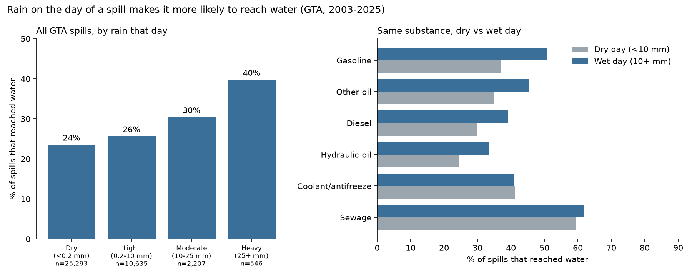
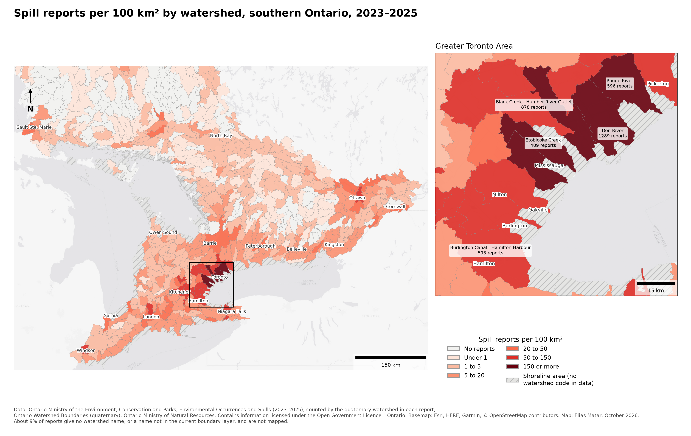
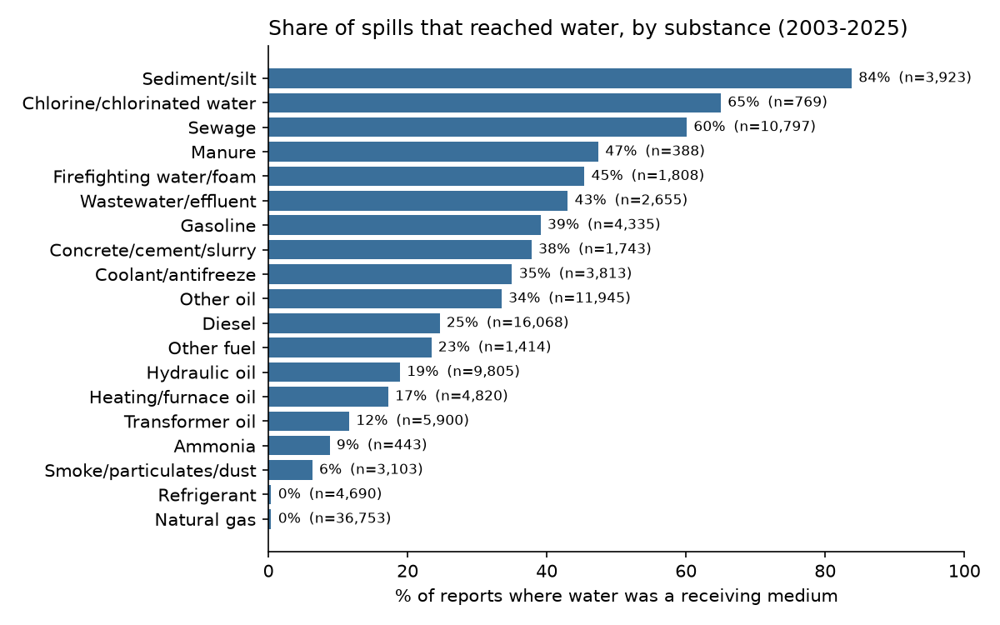

# Ontario Spills: 23 Years of Spills Action Centre Reports

Project page: https://lyesmatar.github.io/eliasmatar/work/ontario-spills.html

**Question:** What gets spilled in Ontario, what reaches water, and how does rain change the impact of a spill?

I built a reproducible Python + SQL pipeline that cleans and combines **146,413 spill reports**
made to Ontario's Spills Action Centre (2003–2025) and links them to daily rainfall at
Toronto Pearson Airport.

## Key findings

1. **Rain makes a spill more likely to reach water, and the effect grows with the rain.**
   Of 38,681 GTA spills, 24% reached water on dry days, 26% on light-rain days, 30% on
   moderate-rain days and **40% on heavy-rain days (25+ mm)**, 1.7 times the dry-day share
   (95% CI 1.52–1.88). For the *same substance*, gasoline, diesel, hydraulic oil and other oils
   were about **1.3 times as likely** to reach water on wet days (10+ mm), with all intervals above 1.
   Sewage and coolant spills showed no change: they reach water at about the same rate either way.
   For response, this means a spill of fuel or oil during rain gives responders less margin before
   it is in a watercourse.
2. **What reaches water depends on the substance.** Sediment/silt (84%), chlorinated water (65%)
   and sewage (60%) usually end up in water. Natural gas, the most-reported substance overall
   (36,753 reports), almost never does.
3. **The Toronto and Region (TRCA) area accounts for about 24% of all Ontario spill reports**
   (5,015 of 21,223 in 2023–2025), more than three times the next conservation authority area (Grand River).
4. **Per area, the Don River watershed has the most spill reports in Ontario** (352 per 100 km² in
   2023–2025), followed by the lower Humber, Etobicoke Creek and the Rouge, all in Toronto.
5. **Weather-caused spills peak in April and July:** spring melt and rain, and summer storms.
   Sewage spills caused by weather follow the same pattern.

## What the pipeline does
| Step | Script | What it shows |
|---|---|---|
| 1 | `src/get_spill_data.py` | Automated download from the Ontario Data Catalogue |
| 2 | `src/build_database.py` | Data cleaning: 4 files, 3 layouts, 3 date formats, 2 text encodings → one SQLite table; duplicate removal; keyword grouping of free-text substances and causes |
| 3 | `src/get_weather.py` | ECCC open-data API; joins two Pearson station IDs into one record |
| 4 | `sql/analysis_queries.sql` + `src/run_analysis.py` | SQL queries (aggregation, filtering, subqueries) run from Python; tables and charts |
| 5 | `src/rain_and_spills.py` | Join of spills to weather by date; risk ratios with 95% confidence intervals |
| 6 | `src/make_map_table.py` + `src/make_map.py` | Spills per watershed joined to the provincial watershed boundaries (geopandas); map of spills per 100 km² |

## Next step: how fast does a spill travel when it rains?
The SAC open data has no containment or response times, so this dataset can't say how fast spills
were contained. The next step is to estimate it: use Water Survey of Canada flow data for a GTA creek
(e.g. Etobicoke Creek) to estimate how quickly a spill would travel downstream at normal flow vs
storm flow. That answers the response question directly: *how much time is there to contain it?*

Run everything: `pip install -r requirements.txt`, then `python run_all.py`.

## Limitations
- **One rain gauge** (Pearson) stands in for the whole GTA, and summer storms are local.
  The real effect is probably stronger than measured.
- **Report dates, not spill dates.** A spill found the day after a storm counts on the next day.
- **Association, not proof of cause.** Rainy-day spills may also differ in where and how they happen.
  Comparing the same substance helps, but doesn't rule this out.
- **Reporting changed over time.** The jump in 2013–2014 most likely reflects reporting or
  system changes, not more spills. Category wording also changed between file versions.
- **Grouping is by keyword:** 15% of reports don't match any group ("Other / not stated").
- Conservation authority and watershed fields only exist from 2023.

## Data
Full citations, download links and file checksums: [data/SOURCES.md](data/SOURCES.md).
All results tables: [data/tables/](data/tables/).

- Ontario Ministry of the Environment, Conservation and Parks, *Environmental Occurrences and
  Spills* (Open Government Licence – Ontario).
- Environment and Climate Change Canada, daily climate data, Toronto Pearson (stations 6158733 / 6158731).

*Built by Elias Matar, October 2026, with Claude (Anthropic) as a coding assistant. I chose the question and
the data, checked the cleaning and results, and wrote the conclusions.*
